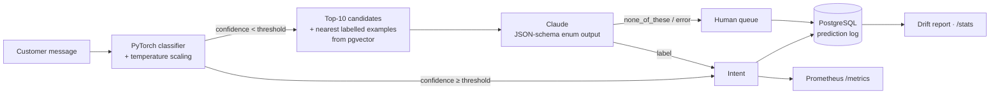

# intent-cascade

[](https://github.com/Adversitas/intent-cascade/actions/workflows/ci.yml)

**Production-style customer-support triage: a PyTorch model handles the messages it's confident about, and passes the rest to an LLM with retrieved examples. Served as a REST API, logged to SQL, and monitored for drift.**

Sending every support message to an LLM is accurate but slow and expensive. Sending everything to a small classifier is cheap, but it fails silently on the hard cases. This project combines the two:

1. A trained model answers when its *calibrated* confidence is above a threshold.
2. Everything else goes to Claude. Claude gets the model's top candidates and similar labelled messages fetched from a vector database, and returns a schema-constrained label.
3. If Claude says nothing fits, the message goes to a human.

The threshold is a single number that trades accuracy against LLM cost, and the evaluation shows exactly what each setting buys.

```
$ intent-cascade classify "my card still hasnt come" "i was charged twice for the same coffee" "what's the weather like"
card_arrival                        model  conf=0.999  my card still hasnt come
transaction_charged_twice           model  conf=1.000  i was charged twice for the same coffee
(human)                             human  conf=0.175  what's the weather like
    model guessed card_delivery_estimate; candidates: card_delivery_estimate, card_arrival, ...
```

*(Without an API key, low-confidence messages go straight to a human. With `--llm` they go to Claude first.)*

> **En bref (FR)** : classification d'intentions pour un support client bancaire. Un modèle PyTorch entraîné et calibré traite les messages dont il est sûr. Les autres partent vers un LLM (Claude), qui reçoit les intentions candidates et des exemples similaires extraits d'une base vectorielle (RAG). Le tout est servi par une API REST (FastAPI), journalisé en SQL (SQLite / PostgreSQL), stocké dans pgvector, supervisé avec Prometheus et un indicateur de dérive (PSI), conteneurisé avec Docker et testé en CI.

## Architecture



| Component | What it does | Where |
|---|---|---|
| **fastText-style classifier** (PyTorch) | Hashed word, bigram and character 3–5-gram embeddings in an `nn.EmbeddingBag`, then a linear head. Trains from scratch in under a minute on a CPU, with sparse gradients (`SparseAdam`) so each step only updates the embedding rows in the batch. Character n-grams make it robust to typos. | [`models.py`](src/intentcascade/models.py) |
| **Embedding + MLP classifier** (PyTorch) | A frozen `bge-small-en-v1.5` sentence encoder with a trained MLP head. Embeddings are cached, so training only runs the head. | [`models.py`](src/intentcascade/models.py) |
| **Calibration** | Temperature scaling fitted with L-BFGS on a held-out split. The cascade routes on confidence, so that confidence has to mean what it says. | [`calibration.py`](src/intentcascade/calibration.py) |
| **Evaluation** | Accuracy, macro-F1, top-k, NLL, ECE, risk–coverage curve / AURC, coverage at a target accuracy, and a threshold table. Includes a TF-IDF + logistic-regression baseline. | [`metrics.py`](src/intentcascade/metrics.py), [`training.py`](src/intentcascade/training.py) |
| **Model registry** | Versioned bundles (weights, temperature, metrics, model card with the training history), plus a `LATEST` pointer. | [`registry.py`](src/intentcascade/registry.py) |
| **Vector store (RAG)** | Nearest labelled examples used as few-shot context for the LLM. Exact search in numpy in-process, or PostgreSQL + pgvector with an HNSW index. | [`vectorstore.py`](src/intentcascade/vectorstore.py) |
| **LLM fallback** | Claude picks from the candidate intents. A JSON-schema `enum` makes inventing a label impossible, and `none_of_these` is the sanctioned way out. Refusals, truncation and API errors become a human hand-off, not a crash. | [`llm.py`](src/intentcascade/llm.py), [`cascade.py`](src/intentcascade/cascade.py) |
| **SQL prediction log** | Every decision is stored through SQLAlchemy (SQLite or PostgreSQL). Agents post the correct label to `/feedback`, and `/stats` reports live accuracy per route. | [`db.py`](src/intentcascade/db.py) |
| **Monitoring** | Prometheus counters and histograms (route, confidence, latency, LLM tokens). PSI drift of the production confidence distribution against the training-time reference. Alert rules. | [`monitoring.py`](src/intentcascade/monitoring.py), [`deploy/`](deploy) |
| **Serving** | FastAPI (`/classify`, `/feedback`, `/stats`, `/drift`, `/metrics`, `/health`). A multi-stage Dockerfile that trains the model during the build, and a docker-compose stack (API + pgvector + Prometheus). | [`api.py`](src/intentcascade/api.py), [`Dockerfile`](Dockerfile), [`docker-compose.yml`](docker-compose.yml) |

## Data

[BANKING77](https://arxiv.org/abs/2003.04807) (Casanueva et al., 2020, CC-BY-4.0): 13,083 real customer messages to an online bank, labelled with 77 fine-grained intents. Many intents are near-duplicates (`card_arrival` vs `card_delivery_estimate`, `top_up_failed` vs `top_up_reverted`), which makes it a realistic test of knowing when to defer. The official test split (3,080 messages) is used only for the final numbers. Validation (10% of train, stratified) drives early stopping and calibration.

## Results

All numbers are on the official BANKING77 test set and are reproducible with `intent-cascade train` and `intent-cascade benchmark`. Latency is per message, batched, on a laptop CPU.

| Model | Accuracy | Macro-F1 | Top-10 | ECE ↓ | AURC ↓ | Traffic kept at ≥95% acc. | Latency | Train time |
|---|---|---|---|---|---|---|---|---|
| TF-IDF + logistic regression (baseline) | 0.910 | 0.910 | 0.997 | 0.017 | 0.0143 | 92.3% | 0.13 ms | – |
| **fastText-style (PyTorch, from scratch)** | 0.914 | 0.914 | 0.997 | 0.013 | 0.0132 | 93.0% | 0.15 ms | 54 s |
| **bge-small + MLP head (PyTorch)** | **0.921** | **0.920** | **0.998** | **0.010** | **0.0119** | **94.2%** | 11 ms | 142 s |

**How the threshold trades accuracy against LLM traffic** (fastText model, test set):

| Threshold | Handled by the model | Sent to LLM | Accuracy on what the model keeps |
|---|---|---|---|
| 0.40 | 98.2% | 1.8% | 0.925 |
| 0.50 | 96.3% | 3.7% | 0.936 |
| **0.60** (default) | **92.7%** | **7.3%** | **0.953** |
| 0.70 | 88.8% | 11.2% | 0.964 |
| 0.80 | 84.9% | 15.1% | 0.973 |
| 0.90 | 78.1% | 21.9% | 0.981 |

**What this shows:**

- **Confidence is a good routing signal.** Overall accuracy is 91.4%, but at a 0.6 threshold the model's own slice is 95.3% accurate while only 7% of messages go to the LLM. Most errors sit in a small, identifiable low-confidence band.
- **The LLM's job is narrow.** The correct intent is in the model's top 10 for 99.7% of messages, so the LLM chooses from about 10 candidates instead of 77. That makes it cheaper and more reliable.
- **The pretrained encoder buys about 0.6 points of accuracy for 70× the latency.** For this traffic, the from-scratch model with a cascade is the better trade. The benchmark makes that decision explicit instead of defaulting to the larger model.
- **Calibration helps both models.** Temperature scaling cut ECE from 0.016 to 0.013 (fastText) and from 0.018 to 0.010 (bge-MLP) without changing a single prediction.

### End-to-end cascade with Claude (`intent-cascade llm-eval`, needs an API key)

`llm-eval` runs the full cascade on a stratified test sample (4 messages per intent). It reports model-only accuracy versus cascade accuracy, the share of messages routed to the model, the LLM and humans, the LLM's accuracy on the deferred slice, token usage and p50/p95 latency. Per-message results are written to JSON for error analysis.

## Quickstart

```bash
git clone https://github.com/Adversitas/intent-cascade.git
cd intent-cascade
python -m venv .venv && source .venv/bin/activate      # Windows: .venv\Scripts\activate
pip install torch --index-url https://download.pytorch.org/whl/cpu
pip install -e ".[dev,api]"

intent-cascade train                    # ~1 min on CPU, writes models/fasttext-<timestamp>/
intent-cascade benchmark                # baseline vs registered models
intent-cascade classify "I still haven't received my new card"
pytest

export ANTHROPIC_API_KEY=...            # enables the LLM fallback
intent-cascade classify --llm "the money i sent my brother never showed up"
intent-cascade llm-eval --output results/cascade.json
intent-cascade serve                    # http://127.0.0.1:8000/docs
```

The pretrained-encoder model:

```bash
pip install -e ".[embeddings]"
intent-cascade train --kind embedding-mlp --lr 1e-3 --epochs 60 --batch-size 32
```

Full stack (API + PostgreSQL/pgvector + Prometheus):

```bash
docker compose up --build
curl -s localhost:8000/classify -H 'content-type: application/json' \
     -d '{"texts": ["my card got declined at the shop"]}'
curl -s localhost:8000/feedback -H 'content-type: application/json' \
     -d '{"prediction_id": 1, "true_label": "declined_card_payment"}'
curl -s localhost:8000/stats
curl -s localhost:8000/drift
```

### Deploying to a cloud

The image is stateless and configured entirely through environment variables (`DATABASE_URL`, `VECTOR_DB_URL`, `ANTHROPIC_API_KEY`, `INTENT_CASCADE_THRESHOLD`), so it runs as-is on any managed container service: Google Cloud Run with Cloud SQL for PostgreSQL, Azure Container Apps with Azure Database for PostgreSQL (pgvector is a supported extension on both), or AWS ECS/App Runner with RDS. Keep the API key in the platform's secret manager, not in the image.

## Design decisions

- **Calibrate before you threshold.** A raw softmax is usually overconfident, and an overconfident model keeps messages it gets wrong. The temperature is fitted on validation data and stored in the bundle with the weights, so the confidence used to route is the calibrated one.
- **Constrain the LLM, then still check it.** The JSON-schema enum limits Claude to real intents, and the code still verifies the label. Any failure (refusal, truncation, network error) degrades to a human hand-off rather than a 500.
- **Retrieval-augmented classification.** The few-shot examples are the nearest *labelled* messages, retrieved with the classifier's own learned embedding (no extra embedding model needed). Their labels are also added to the candidate list, in case the model ranked the right intent outside its top 10.
- **Monitor what you can see immediately.** Production labels arrive late or never. The confidence distribution is available on every request, and it shifts when customers start asking about something new. PSI against the reference histogram saved at training time turns that into one alertable number.
- **One table per model version in pgvector.** Embeddings from different models aren't comparable, so a model rollout never mixes old and new vectors.
- **Everything except the LLM runs offline.** Training, evaluation and the 21 unit tests need no API key. The Claude client is replaced by a recording fake in tests. A separate CI job runs the pgvector and SQL integration tests against a real PostgreSQL service container.

## Limitations and next steps

- **Out-of-scope detection relies on low confidence.** In a quick check, 7 of 8 non-banking messages ("what's the weather like", "tell me a joke") scored below 0.45 and were deferred, but "I want to order a pizza" was labelled `request_refund` with 0.99 confidence. The bge-MLP model also confidently labelled "what's the weather like" as `exchange_rate` (0.61). A dedicated out-of-scope class or an energy/Mahalanobis OOD score would close this gap. The LLM's `none_of_these` only helps for messages that get deferred.
- The end-to-end LLM numbers aren't in this README yet. `llm-eval` produces them, but running it requires an API key.
- The vector store and prediction log were tested against PostgreSQL in CI, not under production load. The Docker image and compose stack were not built as part of this write-up.
- Next experiments: fine-tune the encoder end-to-end instead of freezing it; distil the LLM's decisions on deferred traffic back into the small model (active learning from `/feedback`); per-intent thresholds instead of a global one.

## Project layout

```
src/intentcascade/
  data.py          BANKING77 loading, stratified split, label set
  models.py        fastText-style and embedding-MLP classifiers (PyTorch), training loop
  calibration.py   temperature scaling
  metrics.py       accuracy, F1, ECE, risk-coverage, threshold tables
  training.py      train -> calibrate -> evaluate -> register; TF-IDF baseline
  registry.py      versioned model bundles
  vectorstore.py   numpy and pgvector stores
  llm.py           Claude fallback classifier
  cascade.py       confidence routing: model -> LLM -> human
  db.py            SQLAlchemy prediction log and feedback
  monitoring.py    Prometheus metrics, PSI drift
  service.py       build a serving cascade from env config
  api.py, cli.py   FastAPI service and command-line interface
deploy/            Prometheus config and alert rules
data/              BANKING77 train/test CSVs (CC-BY-4.0)
tests/             unit tests + PostgreSQL integration tests
```

## License

Code: MIT. Dataset: BANKING77 by PolyAI, [CC-BY-4.0](https://github.com/PolyAI-LDN/task-specific-datasets).
